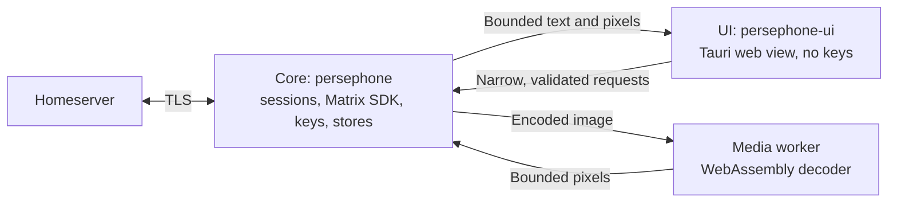

# Persephone

Persephone is a Matrix desktop client for Windows, Linux and macOS, written in
Rust. It is tested against Merovingian first and works with other standard
homeservers. The first release will have one account, rooms, message history,
text and image messages, and end-to-end encrypted chats. It is made for
everyone, but engineered to withstand a targeted attack, not only everyday
threats.

Project page: <https://omg-software.github.io/Persephone/> (source in
[`site/`](site)).

> [!WARNING]
> Persephone is in early development. No milestone has passed its acceptance
> gates, and its production security gates are open. Do not use it for real or
> high-risk conversations yet.

## Status

The [milestone status](docs/architecture/development-plan.md#milestone-status)
lists each deliverable. The [feasibility workbench](docs/planning/feasibility.md)
lists recorded results and open gates.

| OS | State |
| --- | --- |
| Windows | Runs. Live-tested against disposable Merovingian and Synapse servers, and with Element Web. |
| macOS | Builds and passes CI. It has its Keychain vault, prompts and UI host, but it has never run with a display. |
| Linux | Builds and passes CI. The vault, prompts, file dialog and UI host are not built yet, so the core fails closed and does not start the UI. |

On Windows, the app can do these things today:

- Keep an encrypted local profile that opens only with your passphrase
  ([ADR-0006](docs/adr/0006-require-an-unlock-secret-for-the-local-profile.md)).
- Sign in with a password through the core's own native prompt, and sign out.
  Sign-out revokes the session and deletes the local profile. SSO and
  `.well-known` discovery are not supported yet.
- Show the room list and message history. Sliding Sync is preferred, with
  classic sync as the fallback.
- Send and receive encrypted text. Room keys go only to cross-signed devices,
  and you verify your own devices and your contacts by comparing emoji.
  Sending pauses when a contact's identity changes. Sending to an unencrypted
  room needs your consent.
- Start an encrypted direct conversation by Matrix ID, and accept or decline
  direct-message invitations
  ([ADR-0014](docs/adr/0014-start-encrypted-direct-conversations-by-matrix-id.md)).
- Send and receive images. Received images load only when you ask. Sent images
  have their metadata removed.

Not done yet: Linux and macOS runs, keyboard and screen-reader checks, signed
releases, and an independent security review.

## Downloads

The [`latest` pre-release](https://github.com/OMG-Software/Persephone/releases/tag/latest)
is the newest build of `main`. It is unsigned, and it is replaced after each
merge. A build publishes only if its commit is still the tip of `main` when
the build ends. After quick merges, `latest` can therefore be behind `main`
until the newest build ends. To see which build you have, read the revision
in the app's version line. No signed release is available yet. See
[Releases](docs/release.md).

## Architecture

Persephone runs as separate processes, so that the code that draws hostile
content holds no secrets
([ADR-0004](docs/adr/0004-separate-the-key-holding-core-from-the-web-view-process.md)).

- **Core** ([`crates/core`](crates/core)). The entry process. It owns the
  sessions, the Matrix SDK and its cryptography, the encrypted stores, the keys
  and the media broker.
- **UI** ([`src-tauri/`](src-tauri), [`frontend/`](frontend)). A keyless Tauri
  host with a bundled Svelte interface. It relays each allowed command to the
  core as one bounded frame.
- **Media worker**. A contained process that decodes images in a WebAssembly
  guest. The guest has no network or file access. On Windows, the worker
  process itself is not network-denied yet
  ([ADR-0003](docs/adr/0003-run-untrusted-media-decoding-in-a-webassembly-sandbox.md)).

## Why a web view

A common belief is that a native UI toolkit is safer than a web view. For
Persephone, the web view is the more secure design. The page that draws
hostile content runs in the engine's renderer sandbox, under a UI process that
holds no keys. Only bundled code runs. Received text stays inert, and received
images never reach the web engine's decoders. The UI can ask only for narrow
operations that the core validates.

This is a design argument, not a tested ranking. Persephone's own controls
are verified on Windows only, and it has not tested the renderer sandbox. The
[security design note](docs/architecture/security-design.md#why-a-web-view)
gives the full reasons, the evidence for each control and the limits.

## Development

Run these commands from the repository root. They use the committed
`Cargo.lock` and `frontend/package-lock.json`.

| Command | Purpose |
| --- | --- |
| `python tools/dev.py bootstrap` | Install the locked frontend dependencies (run once) |
| `python tools/dev.py check` | Rust, frontend, contract drift and Python harness checks |
| `python tools/dev.py audit` | OSV dependency audit (needs network access) |
| `python tools/dev.py sandbox --offline` | Windows native containment gate |

The sandbox gate currently exits 1 on Windows, because the AppContainer worker
is not network-denied. Image decoding is therefore done in the WebAssembly
guest (ADR-0003). On other OSes the command exits 2 as unsupported. After a
build, run the app with `.local/build/rust/debug/persephone.exe`. Add `--demo`
to see synthetic rooms without a profile. See [Development](docs/development.md)
for prerequisites, output paths and the component layout.

## Documentation

- [Documentation index](docs/README.md): plans, decisions, evidence and research
- [Architecture decision records](docs/adr/index.md)
- [Security policy](SECURITY.md) and [privacy notice](PRIVACY.md)

## License

The GNU General Public License v3.0 applies. See [LICENSE](LICENSE).
