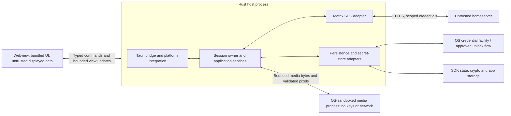

# Architecture and development plan

19 October 2026. This is the implementation blueprint for Persephone. Tauri and
Sliding Sync preference are accepted decisions; the module layout, starting
budgets, and other implementation choices below are recommendations to validate
in the first development milestones. No application has been scaffolded or
security-tested yet.

P0 has started: the [feasibility workbench](../planning/feasibility.md) records isolated
shared components, completed checks and open gates. These results do not establish
production protection or complete P0.

## Requirements and scope

Build a Rust Matrix desktop client for Windows, Linux, and macOS. Use Tauri with
a locally bundled UI, support general Matrix homeservers, and test Merovingian
and Synapse first. Prefer compatible Sliding Sync, with classic `/sync` as the
fallback when Sliding Sync is unavailable. Messages, including decrypted
messages, and all server-supplied names, links, images, and metadata are untrusted.

The first usable release includes one account, login/session restoration, room
list, paginated history, text and image messaging, and encrypted conversations.
Device verification and recovery handling are part of that encrypted experience.
Calls, multiple simultaneous accounts, plugins, rich HTML, remote web embeds,
full-text search, durable offline sending, and custom themes are outside the
initial implementation scope; later inclusion needs an explicit decision.

Accepted decisions take precedence over recommendations here:

* [ADR-0000: Tauri](../adr/0000-use-tauri-for-the-desktop-client.md).
* [ADR-0001: Sliding Sync with classic fallback](../adr/0001-prefer-sliding-sync-with-classic-sync-fallback.md).
* [ADR-0002: SDK-owned Matrix cryptography and explicit features](../adr/0002-use-sdk-owned-matrix-cryptography-and-explicit-features.md).

## System structure



The host's modules share a process; crate boundaries do not isolate them.
The webview/core boundary and media sandbox are security boundaries to verify
on every platform. Tauri's core is privileged: its IPC permissions do not
sandbox unsafe core code. Renderer compromise still exposes displayed plaintext
and can misuse permitted UI actions. A compromised OS, authorized recipients,
and copies made by other applications are outside the guarantees we can make.

Use one Rust session owner for the single active account. Avoid a separate
crypto daemon, application server, or database service for the MVP. Introduce
additional processes only for a demonstrated security or operational need.

### Responsibilities

| Component | Owns | Must not own or expose |
| --- | --- | --- |
| Frontend | View state, accessible controls, bounded timeline display, user input | Long-lived tokens/keys, arbitrary filesystem/network access, protocol state |
| Tauri bridge | Command registration, caller-window checks, native dialogs, lifecycle, OS adapters | Business decisions based only on frontend assertions; catch-all system commands |
| Session owner | Account lifecycle, task supervision, authorization, send orchestration, sync-mode switching | Unbounded work queues or a global lock held across network operations |
| Matrix adapter | SDK client, auth, sync engines, timeline/room projection, E2EE APIs | Custom Matrix cryptography, UI types, homeserver-specific behavior in presentation |
| Storage adapters | SDK stores, app settings, protected session material, migration/retention policy | Unreviewed plaintext event/media caches or raw store access from JavaScript |
| Media broker | SDK media retrieval, file selection handles, budgets, sandbox startup, output validation | Decoding hostile formats in the key-holding process |
| Media worker | Allowlisted decoding/processing in a constrained process | Tokens, key material, arbitrary paths, inherited secrets, network access |

## Current repository layout

The repository currently contains two shared Rust building blocks, integration
and platform test programs, a static frontend, and the development tools. These
components remain feasibility work; no desktop application has been scaffolded.

```text
Cargo.toml                         # Workspace for shared crates and test programs
Cargo.lock                         # Single committed Cargo resolution
.cargo/config.toml                 # Rust build output under .local/build/rust
crates/
  contracts/                       # Shared DTO and contract-generation code
  media-broker/                    # Contained-worker launcher (Windows prototype)
  media-decoder/                   # PNG/JPEG decoder, wasm32 guest
  media-protocol/                  # Shared byte-budget and framed protocol code
  media-sandbox/                   # wasmi host for the decoder guest
  media-worker/                    # Contained worker binary
tests/
  matrix/                          # Matrix sync and encrypted-messaging integration tests
  storage/                         # Encrypted-store and credential API tests
  platform/windows/                # Windows containment test program
frontend/                           # Svelte static UI feasibility implementation
tools/
  dev.py                           # Repository checks and run entry point
  matrix_restart.py                # Disposable Rust worker restart controller
  matrix_capabilities.py           # Controlled sync-capability integration runner
  audit_dependencies.py            # OSV Rust dependency audit
  servers/                         # Disposable Merovingian/Synapse harness
docs/
  adr/                             # Accepted and proposed decisions
  architecture/                    # Architecture and security plans
  evidence/                        # Run records and verification artifacts
  planning/                         # Project plan and feasibility status
  research/                         # Framework security research
.local/
  cache/cargo/                      # Cargo download cache
  cache/npm/                        # npm cache
  build/rust/                       # Cargo build output
  build/frontend/                   # Frontend build output
  runs/                             # New synthetic test profiles and output
  servers/merovingian/              # Local Merovingian helper binary
  servers/synapse/                  # Isolated Synapse virtual environment
```

`contracts` and `media-protocol` are shared building blocks, but remain
provisional and are not security-approved application components. The test
programs exercise bounded scenarios; their results do not establish production
protections or close the P0 phase. The frontend builds static assets and is not
wired to a Tauri application. See the [development guide](../development.md) for
current commands and toolchain details.

## Planned application layout

Extend the existing frontend and shared crates toward the layout below in P1
and later. The Tauri host, application core and media worker do not exist yet:

```text
frontend/
  src/components/                  # Room list, timeline, composer, security flows
  src/features/                    # Auth, rooms, verification, recovery, settings
  src/bridge/                      # Typed IPC facade; no scattered raw invoke calls
  src/generated/                   # Generated public DTO types
src-tauri/
  src/                             # Thin Tauri host and platform integration
  capabilities/                    # Explicit production capabilities
  permissions/                     # Application command permissions
  tauri.conf.json
crates/
  contracts/                       # Explicit public DTOs
  media-protocol/                  # Bounded worker protocol
  core/                            # Session owner, services, Matrix/storage adapters
  media-worker/                    # Independently constrained binary
tests/
  fixtures/                        # Synthetic malicious events/media, no real chats
  matrix/                          # Real SDK / disposable homeserver checks
  storage/                         # Store and credential integration checks
  platform/                        # Sandbox, storage, webview and packaging checks
```

Process structure ([ADR-0004](../adr/0004-separate-the-key-holding-core-from-the-web-view-process.md)):
the core is the entry process and holds sessions, keys, stores and the media
broker; it starts the Tauri UI process, which holds no secrets and relays each
allowed command to the core as one bounded frame.

Dependency direction: frontend consumes generated contracts through its bridge;
the Tauri host depends on contracts/core; core depends on contracts and the SDK;
the worker depends on its protocol and chosen decoders, never core or Tauri.
The SDK, filesystem, clock, credential facility, and media launcher are concrete
adapters behind narrow seams for behavioral tests. Avoid abstracting every
function or duplicating the SDK's entire event/crypto model.

Working frontend recommendation: **TypeScript, Svelte, and Vite**, built as local
static assets, without server-side rendering or a production Node service.
This is a proposed implementation choice, not an accepted ADR or security ranking.
Validate escaping, CSP compatibility, keyboard/screen-reader behavior, timeline
performance, and dependency policy in P0/P1 before recording its adoption.
Use semantic HTML and ordinary escaped bindings; prohibit raw `innerHTML`,
Svelte `{@html}`, server-controlled attribute spreading, and downloaded fonts
in message presentation. Add controlled rich text only through a later review.

## Runtime ownership and concurrency

The session owner controls one SDK client and one active sync engine. Use the
async runtime supported by the selected SDK; keep blocking file/media work off
the UI/event-loop thread. Bounded worker tasks report results to the owner.
Do not serialize whole network transfers behind the owner's message loop.

P0 must document which selected SDK handles and operations support concurrency,
and which task owns sync, mutable timeline projection, and store lifecycle.
Use supported SDK synchronization internally; do not add an ad hoc global
`Arc<Mutex<Client>>` as a substitute for ownership. Test live sync, concurrent
history pagination, key/to-device updates, and cancellation/mode switching
together before relying on this model.

Track account lifecycle separately from synchronization:

* Account: `SignedOut -> Authenticating/Restoring -> Active -> LoggingOut -> SignedOut`.
  An existing protected session starts `Locked`; failed unlock remains locked.
* Sync: `Stopped -> Discovering -> StartingSliding/StartingClassic -> Live`;
  transient errors enter `Retrying`, mode changes enter `Switching`, and
  credentials requiring attention enter `AuthenticationRequired`.
* Verification and recovery use the SDK's own state machines, projected into
  explicit UI states rather than inferred from a successful network request.

Issue a new backend-owned session generation on login/restore and invalidate it
at the start of lock/logout. Requests, subscriptions, worker handles, pagination,
and completions belong to that generation. Revalidate context when executing
work and before publishing results; stale tasks cannot update another session,
write to its store, or reuse media/file handles. A frontend-supplied generation
is a freshness check, not an authorization credential.

On lock/logout: reject new protected work, invalidate subscriptions and clear
frontend state/canvases immediately. Signal cooperative stop between complete
SDK operations and retain all admitted response/store processing until joined.
Stop media workers through their separate containment lifecycle. Close/release
SDK resources only after relevant writers have completed. A deadline or cancelled
shutdown waiter leaves a protected partial failure: it cannot authorize a new
store owner or successful lock status. The [SDK completion contract](sdk-lifecycle.md)
defines the required task coverage; the current fixture proves partial ownership
only. Never report remote token revocation as
successful if its request failed. Distinguish local sign-out from remote
revocation failure, and warn about unrecovered encryption keys before destructive
logout/reset. Dropping objects is not proof that all key copies were zeroized.

Prevent simultaneous writers to an account store, including a second app
instance. Test crash/restart and stale-lock behavior; do not bypass the SDK's
store-locking requirements. Do not support account switching UI initially,
but test logout followed by login as a different user.

## Matrix integration and sync negotiation

Use the maintained Matrix Rust SDK for authentication, protocol state, media
cryptography, device verification, key sharing, and recovery. Pin the exact
release/features after a compatibility spike; do not implement cryptographic
primitives or silently work around server defects in the UI.

Hide sync differences behind one application-facing `SyncCoordinator` and room/
timeline projection. It owns two sequentially used adapters:

* **Sliding adapter:** supported native Sliding Sync, initially evaluate the
  SDK's high-level room-list/sync service and its required extensions.
* **Classic adapter:** SDK `Client::sync`/equivalent classic `/sync` support,
  projecting rooms and timelines into the same application contracts.

Discovery must identify the **specific variant the pinned SDK supports**.
Current SDK documentation describes native MSC4186; a generic Sliding Sync
label or older proxy variant is insufficient evidence of compatibility.
Use SDK discovery where suitable, bind results to the validated homeserver and
account context, and refresh after relevant login/discovery changes. Do not
automatically select an external sync proxy or forward credentials to one.

Preserve discovery errors separately from unsupported results. In the reviewed
SDK, `available_sliding_sync_versions()` suppresses `/versions` failures and
can return no versions without reporting the error. Its empty result alone
must not trigger fallback: require a successful, valid capability response or
another positively classified unsupported-protocol result. Verify the exact
chosen SDK's discovery path and test unreachable/malformed `/versions` responses.
See the [documented helper behavior](https://matrix-org.github.io/matrix-rust-sdk/matrix_sdk/struct.Client.html#method.available_sliding_sync_versions).

### Mode-selection policy

| Observation | Behavior |
| --- | --- |
| Compatible Sliding Sync available | Start Sliding Sync by default |
| Compatible variant absent | Start classic `/sync` |
| Correct endpoint positively reports unsupported protocol | Confirm/classify through the adapter, stop the old engine, then fall back |
| Timeout, disconnect, 429, or transient server failure | Retry the selected mode with bounded backoff and server retry guidance |
| Token expiry or invalid credentials | Refresh/re-authenticate as appropriate; no protocol downgrade |
| Invalid TLS, wrong origin, malformed/security-sensitive response | Stop/surface the error; no insecure fallback |
| Expired Sliding Sync position/session | Recover that protocol state using SDK behavior; do not treat it as lack of support |

When switching, stop and await the old engine and its encryption-sync tasks
before starting the other. Preserve account/device identity, key state, and
approved stores. Sliding positions and classic `since` tokens are distinct,
opaque checkpoints: never convert or copy one into the other. Rebuild the
room projection with bounded loading and deduplicate events through SDK identity.
There must never be two competing owners advancing sync/key-processing state.
Validate actual SDK task/cache behavior rather than assuming shared-client
construction makes switching safe.

The pinned P0 SDK source spawns response-processing work that survives caller
cancellation. Aborting and awaiting an outer sync task therefore does not prove
drain. A production stop must retain and await admitted SDK processing before
starting the next mode or store owner; drain timeout leaves a protected failure.
The P0 [encrypted native-to-classic completed-operation switch](../evidence/encrypted-sliding-sync.md)
passed, while in-flight drain remains an open gate. See also
[the SDK investigation](../evidence/matrix-sync.md) and
[the current task inventory and controlled barrier tests](../evidence/sdk-lifecycle.md).
The public encryption-initialization waiter consumes one join handle; a second
wait can return while the first remains pending. `Client::pause()` can also
return while initialization is still pending. Neither is a full SDK shutdown
acknowledgement. Retain application-owned waiters across deadlines and obtain
the missing SDK worker joins before relying on lock/logout or store handoff.

Both adapters must deliver room membership/state, history, to-device messages,
device-list changes, key counts/requests, and other E2EE-relevant updates needed
by the selected SDK. Optional features can differ, but encrypted messaging and
verification cannot silently stop working in fallback mode. Track sync mode,
initialization, retry, and unsupported-feature state explicitly; avoid user-
visible success while key synchronization has failed.

Merovingian and Synapse are the named integration targets for default Sliding
Sync. Record exact server versions/configurations and the root Cargo resolution in results.
Also exercise a real classic-only/controlled capability deployment and
deterministic unsupported/error fixtures; a forced classic test alone does not
prove automatic negotiation works. No current server runtime compatibility is
claimed by this plan.

## IPC contracts and frontend policy

Define explicit serializable DTOs; never serialize internal SDK/core structs or
derive a general debug/export path for session objects. Generate TypeScript
types from the public contracts, or check an equivalent schema-generation path
in CI. TypeScript types do not validate hostile runtime calls.

Initial command families:

| Family | Representative operations | Backend checks |
| --- | --- | --- |
| Session | discover, login, restore/unlock, lock, logout, current status | Validated destination, supported auth flow, lifecycle, bounded secret handling |
| Rooms/timeline | list rooms, subscribe/unsubscribe, page history | Active account, membership/visibility, bounded opaque cursors and subscriptions |
| Messaging | send text, prepare/send selected image, delivery status | Current room/recipient policy, size, idempotency, session generation |
| Security | start/respond/cancel verification, recovery state/setup | Current SDK verification/session identity; no generic key export |
| Media | request preview, cancel, consume bounded pixel handle | Event/room scope, explicit action, quotas, expiry; no arbitrary URL/path |
| Platform | native file selection, approved link opening, permitted settings | Native selection handles; URI/scheme policy; no arbitrary execution |

Use stable error codes with safe UI messages and bounded retry hints. Errors
and events must not include tokens, passwords, recovery material, message bodies,
raw server responses, or local file paths. Scope subscriptions by caller window,
session, and room; return a snapshot plus versioned deltas. Bound pending updates,
signal gaps, and re-fetch a snapshot instead of silently dropping critical changes.

Register explicit custom-command permissions and an explicit capability set;
do not rely on Tauri defaults or a blanket `core:default`. Review event handlers,
plugins, window creation, and custom protocols as additional entry points.
Configure restrictive CSP and navigation policies; allow only the actual bundled
assets and necessary local IPC/media transport. No remote API permissions,
untrusted frames, remote styles/scripts, generic HTTP plugin, or production
development server. Evaluate Tauri's optional Isolation pattern in P0 as an
additional filter, retaining authorization in Rust.

Treat UI requests as potentially attacker-generated. An authorized `send` call
does not prove a person clicked Send. For destructive trust/recovery changes,
evaluate an independent native confirmation/reauthentication path bound to the
exact operation. Do not add a second frontend `confirm` command and describe
that as protection from a compromised frontend. Document residual send/read
authority that normal chat usability requires.

## Authentication, keys, and persistence

Negotiate supported authentication; prefer a well-supported SDK browser-based
OAuth flow where advertised, while implementing the password login path required
by the target deployments. Validate discovery/redirect destinations and never
forward credentials blindly across origins. Bind OAuth callbacks to the pending
attempt; reject unsolicited/replayed callbacks. Keep any login password transient
and out of logs/storage; JavaScript password entry cannot promise zeroized copies.

Separate three different concepts in code and UI: account authentication,
unlocking local encrypted storage, and Matrix recovery/secret storage. Preserve
the SDK device identity and stores across a normal restore; do not silently
create a replacement cryptographic identity when storage is unreadable.

Use one account-scoped SDK state/crypto store and only the SDK-supported event
cache needed by the chosen integration. Keep app settings separate and do not
mirror raw events into another database. Avoid additional persisted decrypted
history, draft, search, or media caches in the MVP. Session restoration metadata
and tokens need their own protection review.

OS credential facilities are candidates for random store-unlocking material:
Windows credential/DPAPI APIs, macOS Keychain, and Linux Secret Service. Record
what each adapter actually protects and whether it enforces user authentication.
If unavailable or locked, stay locked or use an explicitly approved passphrase
flow; never write an unprotected replacement. Start saved sessions locked by
default; automatic unlock must be an explicit later policy choice. Do not label
automatic vault retrieval as user reauthentication.

The SDK's encrypted-store option is **not evidence of whole-file encryption**.
Inspect state, crypto, event-cache and app databases, WAL/SHM/journal files,
temporary files, backups, media, logs and crash artifacts using recognizable
synthetic plaintext. If protection falls short, change the storage integration
or defer the affected optional persistence through a verified path; do not disable
essential crypto persistence and break key continuity. An encrypted VFS/container
or alternative store backend would require its own feasibility review and ADR.

Migrations need schema versions, one writer, transactions where supported,
crash/recovery tests, and rollback/recovery guidance. Never reset a damaged
crypto store silently. Local deletion is not guaranteed secure erasure of SSDs,
OS snapshots, swap, or another process's copies. State those limits accurately.

## Message, verification, and media flows

### Receive and display

1. The SDK receives and validates protocol data and decrypts where appropriate.
2. The core projects bounded view data: sender identity, text, event identity,
   trust/encryption state, and opaque media references. Decrypted bytes stay untrusted.
3. The UI renders escaped text and explicit placeholders. Received content never
   becomes UI definitions, raw HTML, executable handlers, arbitrary URLs, or fonts.
4. Images, avatars, and thumbnails require explicit loading by default and pass
   through the same media broker. No automatic link previews or external fetches.

### Send text and reconcile history

1. Accept a bounded command and assign/track an SDK transaction identity.
2. Recheck active account, joined room, encryption requirement, and recipient
   trust policy at dispatch. Show changes that require user attention.
3. Let the SDK encrypt/send and reconcile local echoes with returned event IDs.
   Render pending, failed, unknown-delivery, and sent states distinctly.
4. Retry the same operation with the same transaction identity where supported;
   never manufacture a second send after an ambiguous timeout. Durable offline
   queues and automatic resend after restart are deferred.

The SDK's own send queue or high-level timeline send APIs can persist/retry work
independently of an app-managed outbox. Inspect and configure the actual send
path, cache, and restart behavior before calling it ephemeral. Initially prefer
a direct request path with verified transaction/retry semantics; adopt SDK queue
features only with the corresponding storage and delivery policy documented.

Merge history by SDK event identities/order, not wall-clock timestamp sorting.
Handle duplicates, limited timelines, pagination gaps, redactions/edits and
unsupported events without corrupting membership, visibility, or trust state.
Use safe placeholders when the MVP cannot represent an event type.

Private-room creation should default to encryption. Existing public unencrypted
rooms need a clear label and an explicit sending policy; encrypted send failure
must never trigger plaintext fallback. Choose the exact unverified-device policy
and key-sharing behavior in P0/P4, backed by SDK tests. Revalidation cannot make
remote membership changes atomic with sending; document and test the SDK's
actual recipient snapshot guarantees.

Verification screens must bind comparison/confirm/cancel actions to the current
SDK request and device identities. Include new devices, changed identities,
withheld/missing keys, expired requests, recovery setup/restore, and destructive
reset consequences. Local-storage unlock secrets and Matrix recovery secrets
must never be conflated or sent to the wrong destination.

### Receive and send images

For incoming media: authorize the event/room reference, use SDK-authenticated
retrieval and encrypted-attachment checks/decryption, then send hostile encoded
bytes to the restricted worker. The host independently checks dimensions,
stride, checked byte-length arithmetic, output format, and ownership before
passing bounded pixels to the UI. Never decode again through a convenience
browser/host image API.

The worker receives **decrypted encoded content** and produces plaintext pixels.
Lack of keys does not make its inputs non-sensitive. Prohibit worker persistence,
logs and crash uploads; constrain temporary storage, retained buffers, handle
lifetime, and cleanup after crashes/cancellation/logout. Minimize plaintext
copies and retention without promising complete zeroization or secure erasure.

For outgoing media: a native file dialog returns an app-owned handle/reference;
the frontend does not nominate arbitrary paths. Open/read with symlink/reparse-
point and change-during-read behavior explicitly defined. Generate previews in
the same restricted worker. For encrypted rooms, use SDK attachment encryption
before upload, then send the event with its encrypted attachment metadata.
Define metadata stripping and whether to preserve the selected original;
never change a user's source file. Cancellation can leave an uploaded server
object; do not promise server deletion or successful message cancellation after
remote acceptance.

No broad asset-directory access, user-controlled local paths, external SVG,
animated formats, downloaded fonts, or document preview plugins in the MVP.
Pixel transfer needs a bounded binary/channel/custom-protocol design proven in
P0/P2; avoid large base64/JSON payloads and unrestricted asset scopes. Media
handles are opaque, session-bound, scoped, expiring, and revoke on lock/logout.

## Media containment and starting budgets

Launch only the expected bundled worker, with explicit inherited handles and a
minimal environment. Restrict filesystem access to required runtime resources,
disable network/process creation, prevent core/store access, and enforce process
lifetime and resource limits. A separate process, restricted working directory,
or native crate with no networking imports is not sufficient containment.

Per [ADR-0003](../adr/0003-run-untrusted-media-decoding-in-a-webassembly-sandbox.md),
the decoder itself runs as a `wasm32-unknown-unknown` module inside the worker,
with an exact allowlist of host imports and no socket, file, clock or process
capability, plus runtime memory and fuel/epoch limits. The OS mechanisms below
remain as the outer layer against runtime escapes.

| Platform | Candidate mechanism to investigate in P0 | Required proof |
| --- | --- | --- |
| Windows | AppContainer/restricted execution plus Job limits and explicit handle inheritance | Forbidden file/store/network/process access fails; memory/time limits and teardown work |
| Linux | Namespaces, restricted mounts, seccomp and resource limits; evaluate bubblewrap packaging | Actual policy blocks forbidden access, including inside supported packaged environments |
| macOS | Separately constrained, signed helper/XPC service and appropriate App Sandbox entitlements | Helper does not inherit excessive app/network rights; restrictions survive packaging/signing |

These are candidates, not validated recipes. Inability to establish the required
policy disables the affected preview path; do not ship an insecure decoding
fallback. The requested image-capable release still requires a verified safe
path on every supported platform or an explicit scope decision.

Initial application budgets below are starting policy proposals for P0/P2,
not Matrix protocol limits or performance claims. Benchmark and record changes
before relying on them; keep limits finite through configuration and input parsing.

| Resource | Starting proposal |
| --- | --- |
| Text body / control request | 16 KiB UTF-8 text; 128 KiB serialized control request; respect smaller server/protocol limits |
| Timeline | 100 events per page; bounded retained window and virtualized DOM |
| Work | 128 queued application requests; 2 media transfers; 1 decoder; 2 history fetches |
| Encoded image | 20 MiB; initially PNG/JPEG only |
| Image output | At most 8192 per dimension, 16 megapixels total, 64 MiB RGBA output |
| Decoder process | Initial 256 MiB memory budget, 10-second wall deadline; test OS-enforced CPU/process limits |

Reject/cancel on budget exhaustion and return a safe error. Include transport
copies and parser allocations in measurements: checking size only after Tauri
or a worker has fully deserialized an enormous payload is insufficient. Define
and test the earliest enforceable transport limits in P0/P1; no unbounded queue,
pixel allocation, retries, cache, or subscription is acceptable.

The [pinned Tauri IPC review](../evidence/tauri-ipc.md) found that ordinary
command handlers receive bodies after transport allocation, and JSON requests
are parsed by the framework before application dispatch. A raw-body command
can enforce an application parse limit, but cannot by itself bound that earlier
allocation. Keep this transport gate open until the selected runtime and all
alternate IPC paths have an enforceable, measured containment strategy.

P0 must also set an aggregate admission/memory budget across the host, admitted
requests, transfers, worker, retained pixel buffers, and webview copies. For
example, 128 maximum-sized control requests alone approach 16 MiB before object
overhead, and media/copy costs add to that. Point limits are not a proof of bounded
total memory. Prefer byte-accounted queues and shared concurrency/admission
controls; measure packaged behavior and include allocation-pressure tests.

## Privacy, diagnostics, and delivery

Default to hidden notification content, no telemetry, no external previews, and
no optional typing/read-receipt/online-presence announcements. Configure and test
SDK behavior explicitly; absence of an app call does not prove absence of traffic.
Clipboard copies and external links require intentional actions and URI policy.
These measures reduce disclosures; they do not conceal Matrix membership or
traffic patterns or establish anonymity. Tor/proxy routing needs a separate plan.

Use allowlisted diagnostic fields: component, safe error code, bounded duration,
and ephemeral correlation ID. Never log event bodies, stable room/user IDs,
credentials, recovery material, or unrestricted Debug dumps. Failure cases and
support exports need the same review as normal operation; disable automatic
crash uploading and inspect local crash artifacts.

Commit Rust/frontend locks, audit exact production and build-time graphs per
target, minimize enabled features, review new dependencies and unmaintained
packages, and record advisory disposition. Recheck the packaged webview/runtime
and native libraries as well as Rust/npm packages. Build-time tools and release
credentials are part of the threat model.

Use signed/authenticated release artifacts, provenance/SBOM records, protected
signing keys, and documented update/rollback policy. Decide updater behavior
before enabling it; never add a generic download-and-execute path. Cross-platform
support requires actual OS runs, not cross-compilation alone.

## Development milestones and acceptance gates

Milestones require explicit acceptance evidence. **No milestone has passed its exit
gate.** P0, P1 and P2 are in progress and P3 has started; the
[milestone status](#milestone-status) below lists each deliverable. Work can be
developed in parallel where independent, but feature acceptance follows its gates.

| Milestone | Deliverables | Exit evidence |
| --- | --- | --- |
| P0 — Feasibility and decisions | Frontend/SDK/version candidates; sync negotiation and concurrency proof; credential/store audit; signed sandbox-launch tests on all OSes; aggregate resource/IPC design | Versioned notes and ADRs; real Sliding Sync against Merovingian/Synapse, fallback/error distinction, safe concurrent SDK operations, denied worker operations, storage coverage findings; unresolved blockers named |
| P1 — Scaffold and safe UI boundary | Proposed workspace, Tauri shell, typed contracts, mock bounded views, explicit permissions/CSP, production asset build; three-OS CI | Each OS builds/launches; denied IPC/navigation tests; hostile text stays inert; no unexpected network/file access; generated contracts checked |
| P2 — Protected lifecycle and media foundation | Session owner, vault/storage adapters, task cancellation, worker broker, pixel transport, baseline limits | Lock/logout/stale-result races and interrupted storage operations tested; sandbox denied-access/crash/limit tests per OS; no required data leakage in artifact inspection |
| P3 — Login, rooms, history and both sync modes | SDK integration, auth/discovery/restore, Sliding default, classic fallback, shared room/timeline projection | Disposable Merovingian/Synapse runs and classic-only profile; pagination/gaps/dedup/restart; mode-switch task cleanup and E2EE-state preservation |
| P4 — Complete encrypted text experience | Send reconciliation, verification, identity changes, recovery setup/restore, recipient policy | Cross-client encrypted send/decrypt, new/replaced devices, withheld keys, recovery on a clean profile, no plaintext fallback, ambiguous-delivery retries |
| P5 — Image messaging | Incoming/outgoing image flows, encrypted attachments, native selection, metadata/cache policy, accessible pixel display | Malformed/oversized/cancelled media; both sync modes; encrypted upload; no arbitrary paths or unsafe decode fallback; user originals unchanged |
| P6 — Product and operational hardening | Keyboard/screen readers, scaling/IME, offline/reconnect behavior, privacy defaults, bounded-load testing, packaging | Actual packaged runs on all targets; hostile-content/IPC fuzz corpus and privacy captures; reviewed dependency and storage evidence |
| P7 — Release readiness | Signed installers/update plan, support/security reporting, independent security review, compatibility report | Completed checks with exit statuses and artifacts; addressed findings; explicit remaining limitations; no high-risk-use claim from a green build alone |

### Milestone status

21 October 2026. This is the single progress summary; other pages link here. A
deliverable is **done** when it is built and its own evidence passes, **partial**
when only part is built or only some platforms or cases pass, and **not
started** otherwise. A milestone's exit gate is met only when its exit evidence
above passes; none has.

| Milestone | Deliverable | State | Evidence and remaining work |
| --- | --- | --- | --- |
| P0 | Frontend, SDK and version candidates | Done | [Versions](../evidence/versions.json), [frontend](../evidence/frontend.md), [dependencies](../evidence/dependencies.md) |
| P0 | Sync negotiation and concurrency proof | Partial | Sliding/classic selection passes on both servers ([capability fallback](../evidence/capability-fallback.md)); SDK stop-and-join is missing ([lifecycle contract](sdk-lifecycle.md)) |
| P0 | Credential and store audit | Partial | [Storage](../evidence/storage.md), [protected store](../evidence/protected-store.md) on Windows; Linux/macOS vaults not tested |
| P0 | Sandbox-launch tests on all OSes | Partial | Windows [contained worker](../evidence/media-worker.md) prototype; no tested Windows policy denies sockets, so decoding runs in a [no-network WebAssembly guest](../adr/0003-run-untrusted-media-decoding-in-a-webassembly-sandbox.md) inside that worker; not yet wired into the app or the Matrix media flow; signing and Linux/macOS not started |
| P0 | Aggregate resource and IPC design | Done | [Frame protocol](../evidence/media-protocol.md), [IPC measurements and core/UI split](../evidence/ipc-transport.md) ([ADR-0004](../adr/0004-separate-the-key-holding-core-from-the-web-view-process.md)) |
| P1 | Workspace, Tauri shell, typed contracts | Done (Windows) | [Tauri shell](../evidence/tauri-shell.md), [contracts](../evidence/contracts.md) |
| P1 | Bounded views | Done | [Synthetic views](../evidence/mock-views.md), [live updates](../evidence/live-updates.md) |
| P1 | Explicit permissions and CSP | Done | [Tauri shell](../evidence/tauri-shell.md): allowlist, capability, CSP, navigation and IPC denial tests |
| P1 | Production asset build | Partial | Frontend build checked; no release or packaged app run |
| P1 | Three-OS CI | Partial | Windows CI ([development guide](../development.md#continuous-integration)); Linux and macOS not built |
| P2 | Session owner | Partial | [Session owner](../evidence/session-owner.md): leases, lock and unlock; [sign-out](../evidence/sign-out.md) deletes the key at once and leaves the store files to the next start, because SDK tasks are not joined |
| P2 | Vault and storage adapters | Partial | [Protected store](../evidence/protected-store.md): Windows DPAPI only |
| P2 | Task cancellation | Partial | Cooperative stop between complete operations; SDK tasks not joined, so lock ends `restart_required` once a client ran |
| P2 | Worker broker | Done (Windows) | [Media worker](../evidence/media-worker.md); Linux/macOS not started |
| P2 | Pixel transport | Not started | Decoded pixels do not reach the UI yet |
| P2 | Baseline limits | Partial | Frame and page budgets, UI Job limits; no aggregate memory admission across features |
| P3 | SDK integration | Partial | [Sign-in evidence](../evidence/matrix-sign-in.md): one client in the core over the encrypted stores |
| P3 | Authentication, discovery, restore | Partial | Native-prompt password sign-in and restore; [sign-out](../evidence/sign-out.md) revokes the session and deletes the local profile; no SSO or `.well-known` discovery |
| P3 | Sliding default, classic fallback | Partial | Initial selection passes live on Merovingian, Synapse and classic-only Synapse; no runtime mode switch |
| P3 | Room and timeline projection | Partial | Room list, history paging, notices and live events; gap and dedup coverage incomplete |
| P4 | Encrypted text experience | Not started | No sending, verification, recovery or key sharing; other devices' messages are undecryptable notices |
| P5 | Image messaging | Not started | The decoder and worker exist (P0, P2) but there is no image flow |
| P6 | Product and operational hardening | Partial | Keyboard and screen-reader checks not done; failed windows detected and retried on Windows; this host's WebView2 crash dumps all fail inside a third-party overlay hook, not tested with it removed ([window retry](../evidence/window-retry.md)) |
| P7 | Release readiness | Not started | None |

Feasibility checks do not grant permission to ship unverified controls.
P3 can use disposable test fixtures while P4 is underway, but an unencrypted
prototype does not meet the first usable release requirement. The release needs
P0–P7 evidence; no delivery date is inferred before platform feasibility is known.

### Initial implementation backlog

1. Resolve the working frontend/SDK versions and public contract-generation approach; record dependency features and licenses.
2. Implement Sliding-default and classic-fallback SDK integration tests against disposable targets; verify required E2EE extensions and switching cleanup.
3. Prototype per-OS credential unlock, SDK store protection, and denied-access media workers before building chat screens.
4. Write threat-to-test cases for IPC escalation, unsafe content, key exposure, storage artifacts, stale sessions, and unsupported sync.
5. Scaffold the conventional Tauri host and thin crates, with one harmless allowlisted command and denied-command tests.
6. Add bounded fixture-driven room/timeline views and screen-reader/keyboard checks.
7. Implement lifecycle/storage and task cancellation, then the two sync adapters and authenticated room projection.
8. Deliver verified encrypted text and recovery, followed by image messaging and packaged platform checks.

## Verification strategy

Use GIVEN/WHEN/THEN cases asserting observable behavior, not private function
calls or incidental event counts. Write defect regressions before fixes. Use
real SDK/store integrations for the guarantees they provide and deterministic
transport/clock fixtures for failure interleavings; mocks alone do not establish
server or OS compatibility.

| Given / when | Required behavior |
| --- | --- |
| HTML/script-like text or deceptive name arrives | Inert rendering, clear identities, no navigation or privileged call |
| Unauthorized window or malformed IPC calls a command | Denied in Rust; no side effect or secret-bearing error |
| Sliding Sync is supported / absent | Preferred Sliding / automatic classic fallback, respectively |
| Capability discovery returns no versions because its endpoint failed | Error/retry state; no unsupported-feature assumption or automatic fallback |
| Sliding times out, credentials fail, position expires, or server rate-limits | Correct retry/auth/protocol recovery; no accidental fallback or duplicate loops |
| Mode switches while encrypted events/key updates arrive | One active owner; no key-state loss, double sends, or skipped required updates |
| Logout/lock occurs during send/history/upload/decode | Stale work cannot publish or enter a new session; remote uncertainty reported accurately |
| Vault key is missing, store is corrupt, or migration is interrupted | Protected failure/recovery; no plaintext fallback or silent identity replacement |
| Image violates policy or worker is compromised/crashes | Limits and denied access hold; safe error; no unrestricted decoder retry |
| Maximum-sized requests/transfers compete under memory pressure | Aggregate byte/concurrency admission holds; no unbounded copies, queues, or retries |
| Recipient identity changes or attachment encryption fails | Policy enforced; no plaintext downgrade or misleading sent state |
| App restarts after ambiguous send acknowledgement | No automatic new transaction/resend that could duplicate the message |

CI should include Rust formatting/lint/tests; frontend type/lint/component checks;
contract drift and permission/configuration checks; exact dependency advisory
review; disposable homeserver jobs for both sync paths; and platform packaging/
sandbox tests. Browser-only UI tests supplement, not replace, real webview tests.
Choose the native UI automation route per OS after checking current support.
Keep source-derived tests, completed executions, manual checks, and skipped
checks separately labelled. A timeout, crash, interrupted run, or missing
artifact is not a pass.

## Decision register and readiness

| Decision | State / when to settle |
| --- | --- |
| Tauri and locally bundled UI | Accepted, ADR-0000 |
| Sliding default, classic fallback | Accepted, ADR-0001 |
| SDK-owned Matrix cryptography and explicit features | Accepted direction, ADR-0002; production resolution conditional |
| Frontend, SDK release/features, contracts | Proposed above; settle in P0/P1 and record durable decisions |
| Local unlock/storage coverage and retention | Required P0 evidence before using real account data |
| OS sandbox and resource enforcement | Required P0/P2 evidence; no silent insecure fallback |
| Unverified-device policy and recovery UX | Required before P4 acceptance |
| Minimum OS/CPU matrix, Linux packaging/display targets | Set in P0; test every claimed target |
| Project repository and license | OMG-Software/Persephone; existing GPLv3 [LICENSE](../../LICENSE) preserved |
| Signing/distribution ownership and contribution policy | Owner input before release; does not block local planning or component development |

The plan itself is complete as a development guide. Product code, exact package
resolutions, interoperability, storage guarantees, and sandbox enforcement remain
unimplemented and unverified. Record meaningful design changes through the ADR
register and update this plan; preserve research reports as evidence snapshots.

## Primary references checked

Documentation checked on 19 October 2026; moving SDK documentation is not a
substitute for testing the exact release selected in P0.

* [Tauri process model](https://v2.tauri.app/concept/process-model/), [capabilities and custom-command defaults](https://v2.tauri.app/security/capabilities/), [CSP](https://v2.tauri.app/security/csp/), [Isolation pattern](https://v2.tauri.app/concept/inter-process-communication/isolation/).
* [SDK Sliding Sync service and MSC4186 requirement](https://matrix-org.github.io/matrix-rust-sdk/matrix_sdk_ui/sync_service/struct.SyncService.html), [version discovery](https://matrix-org.github.io/matrix-rust-sdk/matrix_sdk/sliding_sync/enum.VersionBuilder.html), [classic sync APIs](https://matrix-org.github.io/matrix-rust-sdk/matrix_sdk/struct.Client.html).
* [SDK store configuration](https://matrix-org.github.io/matrix-rust-sdk/matrix_sdk/struct.ClientBuilder.html), [store encryption](https://matrix-org.github.io/matrix-rust-sdk/matrix_sdk_store_encryption/index.html), [recovery](https://matrix-org.github.io/matrix-rust-sdk/matrix_sdk/encryption/recovery/struct.Recovery.html).
* [Svelte text bindings](https://svelte.dev/docs/svelte/basic-markup), [raw HTML warning](https://svelte.dev/docs/svelte/@html), [Tauri frontend integration](https://v2.tauri.app/start/frontend/).
* [Windows AppContainer](https://learn.microsoft.com/en-us/windows/win32/secauthz/appcontainer-isolation), [bubblewrap policy responsibility](https://github.com/containers/bubblewrap), [Apple App Sandbox](https://developer.apple.com/documentation/security/app-sandbox).

