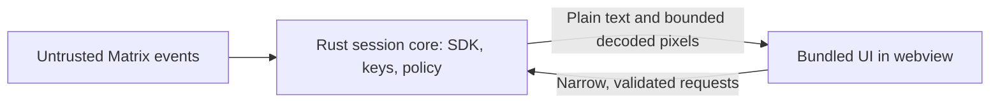

# GTK and Tauri: handling untrusted Matrix content

19 October 2026. Documentation-based comparison and proposed design. No GTK/Tauri dependency probe, packaged application, sandbox verification, or security test was performed in this pass.

Decision update: the project owner has selected Tauri in accepted
[ADR-0000](../adr/0000-use-tauri-for-the-desktop-client.md). The recommendation below
records the preceding research; the ADR is authoritative for the framework choice.

## Answer and recommendation

Tauri can support a secure application architecture. A webview is not a reason to reject it; nor is a Rust backend sufficient reason to approve it. Its process model and frontend/core permission controls make it a serious candidate for Persephone.

The earlier preference for avoiding webviews was too broad as a security argument. A constrained webview can provide useful separation that a single-process native UI lacks. Whether that separation is enforced well enough on each platform needs measurement. Native UI toolkits and Tauri both retain native parsers, rendering dependencies, and operating-system exposure.

Keep Tauri alongside Slint for an architectural prototype comparison. GTK remains a viable native option, particularly for its documented widgets and accessibility, but neither its full cross-platform packaging nor our media/isolation design is verified. This note does not establish a security ranking between the four toolkits.

## Non-negotiable requirement

Messages are untrusted, including after end-to-end decryption. Encryption does not make a malicious participant's message or attachment safe to render. Names, room metadata, links, avatars, and server responses follow the same rule.

Separate three concerns: our reviewed shipped UI code, hostile Matrix data displayed by that code, and the authority of the core process. We should additionally assume that a rendering vulnerability or frontend supply-chain issue could compromise the UI, and limit what it can then access.

## Tauri's model

Tauri can display locally bundled HTML/CSS/JavaScript; it does not require downloading a website or trusting a homeserver to deliver UI code. Its webview renders the interface, while Rust manages application state and privileged operations across an IPC boundary. [Process model](https://v2.tauri.app/concept/process-model/), [security overview](https://v2.tauri.app/security/).

This is our proposed division of responsibilities, not Tauri's default application behavior. The Rust core still parses untrusted network data and needs its own defensive limits. The webview receives displayed plaintext, so compromise of that UI still compromises the content it sees.

Tauri's capabilities restrict which window/webview may call protected interfaces. This is an authority boundary; it does not determine whether a message is safe HTML or prove that a human requested an allowed action. A compromised UI with permission to send messages could misuse that permission even if it cannot retrieve raw encryption keys. [Capabilities](https://v2.tauri.app/security/capabilities/).

## Requirements for a Tauri candidate

1. **Ship the UI locally.** Do not load remote scripts, fonts, application pages, or untrusted frames. Block unintended navigation and new windows independently of restricting API access. A locally bundled page is still vulnerable if message data is inserted as executable markup.
2. **Render bodies as text initially.** Use escaped template bindings or text nodes, never raw message strings as `innerHTML`. Any future rich text needs a deliberately limited representation, controlled links, and a vetted transformation path. CSP is defence in depth, not a substitute for this boundary. [Text content](https://developer.mozilla.org/en-US/docs/Web/API/Node/textContent), [innerHTML injection risks](https://developer.mozilla.org/en-US/docs/Web/API/Element/innerHTML).
3. **Keep long-lived authority in Rust.** Session tokens, cryptographic state, persistence, SDK networking, and authorization belong in the core rather than webview storage. UI password entry, if supported, is a separate transient secret-handling surface. Do not claim the UI can never see sensitive material.
4. **Use application operations, not general system access.** For example, `send_message(room_id, body)` with account/membership/size validation, rather than arbitrary HTTP, shell execution, or arbitrary file reads. Attachment access should use controlled identifiers/handles and explicit selection flows. Review every event listener and plugin as another potential entry point.
5. **Explicitly configure security controls.** Tauri's CSP is enabled only when configured. Tailor it to local assets and the required IPC transport, with no broad remote permissions. Custom application commands registered through `invoke_handler` are allowed from app windows/webviews by default; configure their permissions with `AppManifest::commands` and explicit capabilities. Capabilities can combine, so inspect effective permissions rather than one file in isolation. [CSP](https://v2.tauri.app/security/csp/), [custom-command defaults](https://v2.tauri.app/security/capabilities/#overview).
6. **Preserve the media boundary.** A browser image element with hostile encoded bytes invokes browser decoders. For our stricter design, use an isolated decoder and bounded pixel delivery such as canvas image data, with validated dimensions and no arbitrary path/URL loading. This still needs a practical cross-platform prototype and accessible image descriptions.
7. **Treat platform patching as a dependency.** Tauri uses WebView2 on Windows, WKWebView on macOS, and WebKitGTK on Linux. Maintain supported patched environments and verify packaging, engine versions, and actual containment. The system-webview approach does not guarantee that every user's installation is current. [Webview reference](https://v2.tauri.app/reference/webview-versions/).

Tauri also offers an optional Isolation pattern: a small trusted iframe application can filter IPC before it reaches Rust. It deserves evaluation as an additional defence, with minimal dependencies and backend validation retained. It is not a guarantee of human intent, not Matrix encryption, and not an entire application OS sandbox. Our rule against untrusted embedded frames is distinct from this framework-controlled trusted frame. [Isolation pattern](https://v2.tauri.app/concept/inter-process-communication/isolation/).

For Linux/Android remote API access, Tauri documents an inability to distinguish embedded-iframe requests from the containing window. We do not need that remote API feature for the proposed client and should leave it disabled. Its capabilities documentation also explicitly excludes unsafe Rust handlers, overly broad scopes, webview vulnerabilities, and developer-system compromise from its guarantees. [Documented limits](https://v2.tauri.app/security/capabilities/#remote-api-access).

## GTK's model and caveats

GTK is a native C-based toolkit supporting Linux/Unix, Windows, and macOS. gtk-rs provides Rust bindings over that stack; it does not convert GTK or its native dependencies into memory-safe Rust. GTK itself is not the application's OS sandbox. [GTK architecture](https://docs.gtk.org/gtk4/overview.html), [Rust API and FFI](https://docs.rs/gtk4/latest/gtk4/).

For untrusted text, `GtkLabel.set_text` displays text and disables markup for that label. `set_markup` instead parses Pango markup; GTK documents escaping external strings. Controlled markup does not execute browser JavaScript, but formatting, links, Unicode, and resource use still require policy. No server-supplied UI definitions should be loaded. [Plain text](https://docs.gtk.org/gtk4/method.Label.set_text.html), [markup](https://docs.gtk.org/gtk4/method.Label.set_markup.html).

GTK explicitly warns against `GtkPicture.set_file` with untrusted data and recommends a proper image-loading framework such as libglycin before displaying a texture/paintable. Glycin documents sandboxed decoding **on Linux**. This is an integration option, not an automatic GTK guarantee or evidence of identical Windows/macOS isolation. [Image API warning](https://docs.gtk.org/gtk4/method.Picture.set_file.html), [glycin documentation](https://github.com/GNOME/glycin/blob/main/README.md).

GTK has documented accessibility integration, but actual controls, keyboard navigation, screen readers, packaging, and dependencies must be tested on each target. Flatpak can provide an additional Linux application sandbox; its permissions and runtime are separate from the choice of GTK. [Accessibility](https://docs.gtk.org/gtk4/section-accessibility.html), [Flatpak concepts](https://docs.flatpak.org/en/latest/basic-concepts.html).

## Practical comparison

| Question | GTK/gtk-rs | Tauri |
| --- | --- | --- |
| Is a web engine needed for the native UI? | No | Yes |
| Can chat text be displayed as data? | Yes, text APIs | Yes, escaped bindings/text nodes |
| Is remote message HTML automatically safe? | Pango markup is a different parser, still needs policy | No; unsafe HTML insertion can create XSS |
| Is Rust a guarantee over the full stack? | No, native C/FFI dependencies remain | No, native webview/OS plus frontend dependencies remain |
| Is UI/core separation provided by the basic architecture? | Must be designed for the app; do not assume it | Framework provides a process/IPC model, with permissions to configure |
| Is strict media isolation automatic on all three OSes? | Not established | Not established |

The deciding question is what a hostile message or compromised renderer can cause outside its intended authority. A small parser surface and strong containment are separate advantages; neither the word 'native' nor 'web' answers both.

## Evidence limits and next checks

This pass inspected official API/security documentation and independent source checks of the material GTK claims. Moving documentation was checked on the research date; no specific application dependency graph was selected for GTK or Tauri. This is less implementation-specific than the separate Slint/iced dependency investigation.

Before any adoption, verify exact released versions/dependencies, effective command permissions including negative tests, CSP/navigation enforcement with hostile-message cases, frontend storage and network behavior, platform sandbox behavior, media limits, and compromised-UI misuse of allowed actions. No framework is approved by this note.

Confidence: 95% in the described model and documented caveats; comparative product security remains unverified.
