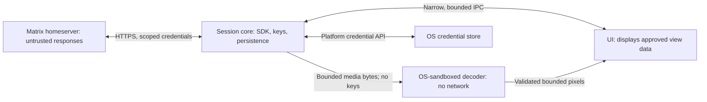

# Security design and UI decision brief

19 October 2026. Planning only: no controls have been implemented or tested. The high-risk-user objective and Tauri framework choice are confirmed; the ADR's security constraints apply, while detailed mechanisms and defaults remain proposals.

The framework choice is now accepted: [ADR-0000](adr/0000-use-tauri-for-the-desktop-client.md)
selects Tauri with a Rust core and locally bundled web UI. The record's security
constraints govern implementation; detailed mechanisms and verification remain outstanding.

Follow the [architecture and development plan](architecture-plan.md) for runtime
ownership, IPC, storage, media handling, implementation order, and test gates.
[ADR-0001](adr/0001-prefer-sliding-sync-with-classic-sync-fallback.md) selects
Sliding Sync by default with classic `/sync` fallback when unavailable.

## Objective and limits

Protect account credentials, device identity and encryption keys, message content, local history, and user intent against hostile messages/media, malicious participants or homeservers, network interception, dependency compromise, and targeted exploitation.

Confirmed requirement: messages remain untrusted after decryption. Server-supplied names, links, avatars, attachments, and other event data receive the same treatment.

Reduce unnecessary metadata disclosure and document unavoidable disclosure. General Matrix compatibility does not provide anonymity. A compromised operating system or authorized recipient can access content outside the client's control. The UI necessarily receives content it displays; separating keys from that UI cannot prevent all content theft or malicious actions after UI compromise.

Security is an engineering objective with measured evidence, not a claim that any framework or product is the most secure.

## Threats and proposed controls

| Threat | Proposed control | Required evidence |
| --- | --- | --- |
| Malicious event, formatting, display name, or URL | Parse into bounded application data; support an allowlist of formatting; never interpret received content as executable UI; guard deceptive links and identity displays | Parser/resource-limit tests; spoofing and navigation review |
| Malicious image, avatar, thumbnail, or attachment | Explicit media loading by default, format allowlist, byte/pixel/time limits, sandboxed decoder without keys or network | Attempt forbidden filesystem/network operations from helper on each OS; exercise malformed images and output limits |
| Server or participant substitutes device identities | SDK-based device verification and cross-signing; explicit identity-change handling; evaluate verified-recipient-only sending | Tests with new/unverified/replaced devices, withheld keys, and changes during send |
| Network interception or malicious discovery/redirect | HTTPS with certificate validation, destination validation, and credential scoping; no production bypass | Discovery and redirect tests proving credentials cannot leak to unrelated destinations |
| Stolen local files or unintended persistence | OS-protected secret storage, encrypted sensitive persistence, explicit cache/retention policy | Inspect actual database, journals, backups, media caches, logs, and crash paths; test locked/missing credential store |
| Message/identity leak through convenience features | No automatic link previews or external URL fetches; notification text hidden by default; no analytics by default | Network capture and local artifact inspection under representative operations |
| Dependency or update compromise | Minimal dependency features, committed lockfile, advisory/license review, reviewed updates, authenticated release/update chain | Dependency inventory, provenance records, signature/tamper tests, rollback policy |
| Denial of service | Bound event/media sizes, queue sizes, histories, retries, and concurrent work; keep UI responsive | Adversarial workloads with measured memory, time, and recovery behavior |

These are acceptance criteria; SDK and platform behavior must be checked before claiming coverage.

## Proposed process boundaries

- The session core owns tokens, cryptographic state, trust decisions, and account-scoped data. It must also treat server responses as hostile.
- The UI gets only the data and operations it needs. Do not expose generic filesystem, shell, network, raw key export, or arbitrary decryption commands.
- IPC needs peer authentication/handle ownership, message limits, explicit command schemas, lifecycle handling, and authorization in the receiving process.
- UI requests remain untrusted input to the core. A compromised UI can still misuse permitted operations; process separation reduces authority but does not establish human intent.
- Media isolation applies to avatars, thumbnails, and pasted/received images as well as full-size attachments. Decode before the UI sees the image; avoid silently decoding it again through an unrestricted UI component.
- A separate process is not a sandbox. Filesystem, process, network, and resource restrictions must be enforced and tested per OS. Disable unsupported preview paths rather than silently using an unrestricted decoder.
- Font shaping, graphics drivers, IPC parsers, and native libraries remain relevant even with a Rust UI. Inventory and minimize that surface.

This split is a design candidate. Prove it works with the selected toolkit, SDK, packaging model, and each supported OS before freezing the architecture.

## Encryption, persistence, and privacy decisions

- Use the maintained Matrix Rust SDK and its cryptography rather than implementing a protocol or cryptographic primitives ourselves. Validate the exact release/features selected.
- Make encryption and recipient trust visible. Never silently fall back to plaintext when encrypted sending fails. General Matrix support may include public unencrypted rooms; distinguish those clearly and decide their policy explicitly.
- Propose encrypted private-room creation by default. Select and test key-sharing, cross-signing, identity-change, verification, recovery, and encrypted-attachment behavior together.
- Verified-only sending increases onboarding and device-replacement friction. Decide its default after a prototype demonstrates what users must do and which guarantees the SDK actually enforces.
- Specify recovery before promising durable encrypted history. Encrypted backup protects availability only if recovery secrets and identity authentication are handled correctly; losing all recovery material may lose history access.
- Keep passwords out of persistent storage. Protect tokens and store-unlocking material through an OS credential facility or an explicitly designed passphrase flow; never silently fall back to plaintext files.
- Do not equate the SDK's store passphrase option with full database encryption. Verify protection of decrypted events, identifiers, indexes, SQLite journals, backups, and caches separately. Storage gaps block a high-risk release until resolved or the affected persistence is disabled through a verified path.
- Hide notification content by default; make clipboard copying, external links, and attachment opening explicit user actions. Do not promise reliable erasure of clipboard history, swap, snapshots, SSD blocks, or other applications' copies.
- Minimize retained media and diagnostic data. Logs must exclude secrets and message bodies; any diagnostic export requires a separate disclosure review.
- Inventory metadata by recipient: homeserver, federated servers, other room members, OS services, and network observers. Optional receipt/presence/typing choices reduce particular disclosures but do not remove room membership or traffic-pattern exposure.
- Proxy/Tor support, DNS behavior, and traffic-correlation defenses require a separate network design and leak tests; do not label the baseline client anonymous.

## UI choices

The comparison concerns architecture and feasibility, not a measured security ranking. Frameworks do not by themselves provide the application's required sandbox.

The [GTK/Tauri security-model comparison](gtk-tauri-security-model.md) informed the accepted Tauri decision: bundled web UI can be separated from Rust authority, while permissions, content rendering, and platform containment require deliberate configuration and tests. Avoiding a webview alone is not a sufficient security argument. No GTK/Tauri dependency or application test has yet run.

Follow-up [Slint/iced security research](slint-iced-security-research.md) inspected pinned releases and resolved reduced-feature dependency probes. It found meaningful reservations for both: Slint's native Winit path retains image/SVG parsers and Linux maintenance warnings; iced's software path can omit codecs, while its GPU path selects an advised `lru` version. Slint's explicit security policy and accessibility path support keeping it on the shortlist, without an overall security ranking or release approval.

| Choice | Programming model | Security/design considerations | Initial position |
| --- | --- | --- | --- |
| Slint | Rust application logic plus declarative `.slint` UI definitions | Can use a non-webview renderer; inspect chosen backend, parsers, and native dependencies. Review framework license and prove text/accessibility behavior on each OS. | Strong native feasibility candidate; awaiting comparative tests |
| iced | UI and application logic expressed in Rust | Avoids an HTML/JS frontend. Rendering/windowing dependencies still matter. Upstream accessibility work remains an explicit concern; screen-reader support must be demonstrated for the selected release. | Alternative if Rust-authored UI is a priority and usability gates pass |
| GTK4 with gtk-rs | Rust bindings over GTK's C toolkit | Documented accessibility integration; native dependencies and packaging form part of the trusted computing base. Cross-platform support does not prove equal behavior everywhere. | Alternative if toolkit widgets/accessibility fit better |
| Tauri | Rust backend plus HTML/CSS/JavaScript in a system webview | Offers capability controls and CSP. Webview isolation may help containment, but frontend content, IPC permissions, runtime patching, and supply chain need review. Native alternatives need their own containment too. | Accepted in ADR-0000; implementation and verification outstanding |

The earlier Slint-first proposal remains recorded in its research report. ADR-0000 settles the framework choice as Tauri; the alternatives above preserve the comparison that informed it. Limiting parsers and containing a compromised renderer remain separate objectives.

Slint has GPLv3, royalty-free, and commercial framework license choices; confirm exact terms and project distribution before adopting it. Rust syntax throughout is a separate preference from using Rust for application logic.

## Feasibility and release gates

1. UI prototype: long/hostile timelines, Unicode and bidirectional text, IME, selectable text, keyboard navigation, screen readers, scaling, secure identity presentation, and responsive updates on all three OSes.
2. SDK compatibility: verify discovery/authentication, supported synchronization mode, history, E2EE, verification, recovery, and media against the current Merovingian revision and a separate reference homeserver. High-level SDK UI services must not accidentally restrict general homeserver support.
3. Isolation prototype: prove media helper restrictions and bounded IPC on every OS; test denial of permissions and worker crashes. Record what remains in the core/UI process.
4. Storage review: inspect persistence and encryption coverage, unavailable credential stores, account isolation, restart/logout, recovery, and migration behavior. Do not make deletion or encryption promises based on API names.
5. Security verification: targeted tests, fuzzing of app-owned parsers/IPC, malformed event/media corpus, dependency review, release hardening, and independent review before high-risk-use claims.
6. Distribution: establish supported OS/security-patch baselines, authenticated packages/updates, protected release credentials, and vulnerability response procedures.

## Sources checked

Primary sources checked on 19 October 2026; moving documentation must be rechecked when versions are selected.

- [Matrix Rust SDK](https://github.com/matrix-org/matrix-rust-sdk): SDK role and public client libraries.
- [SDK ClientBuilder](https://docs.rs/matrix-sdk/latest/matrix_sdk/struct.ClientBuilder.html): storage, discovery, and transport configuration APIs; not a complete storage security guarantee.
- [SDK sync service](https://docs.rs/matrix-sdk-ui/latest/matrix_sdk_ui/sync_service/index.html): high-level synchronization API and error-state handling.
- [Matrix Client-Server specification](https://spec.matrix.org/latest/client-server-api/): encryption, device verification, attachments, room membership, presence, and receipts.
- [Slint getting started](https://docs.slint.dev/latest/docs/slint/guide/getting-started/): declarative UI and application integration.
- [Slint framework licensing](https://github.com/slint-ui/slint/blob/master/LICENSE.md): current licensing choices.
- [iced](https://github.com/iced-rs/iced) and [accessibility tracking issue](https://github.com/iced-rs/iced/issues/552): Rust UI model and open accessibility work; no platform certification inferred.
- [GTK overview](https://docs.gtk.org/gtk4/overview.html) and [accessibility documentation](https://docs.gtk.org/gtk4/section-accessibility.html): native toolkit and accessibility design.
- [Tauri capabilities](https://tauri.app/security/capabilities/): permission boundaries and stated limitations.
- [Tauri architecture](https://tauri.app/concept/architecture/) and [CSP](https://tauri.app/security/csp/): webview architecture and web-content restrictions.
